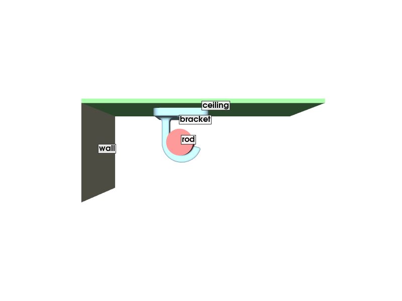
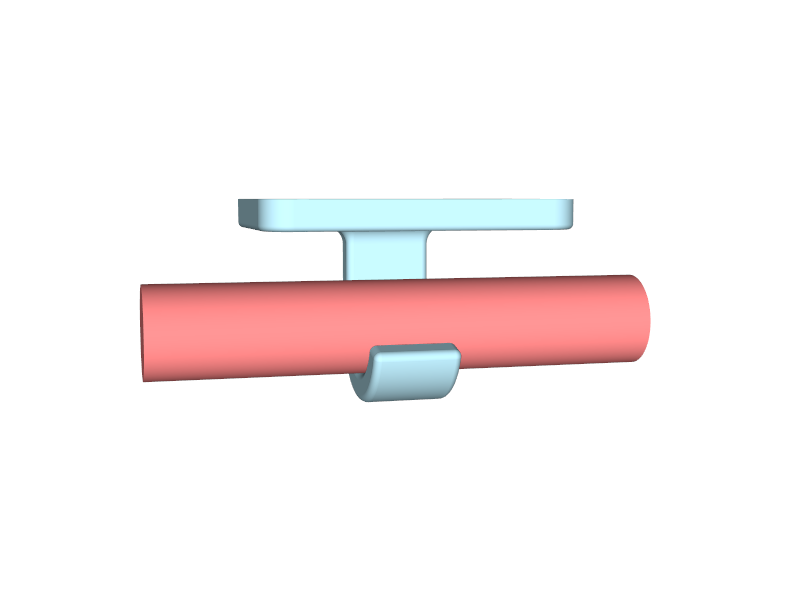
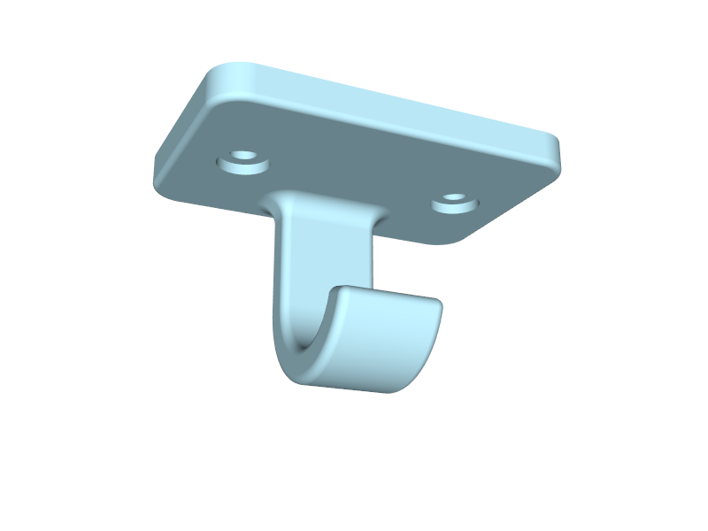
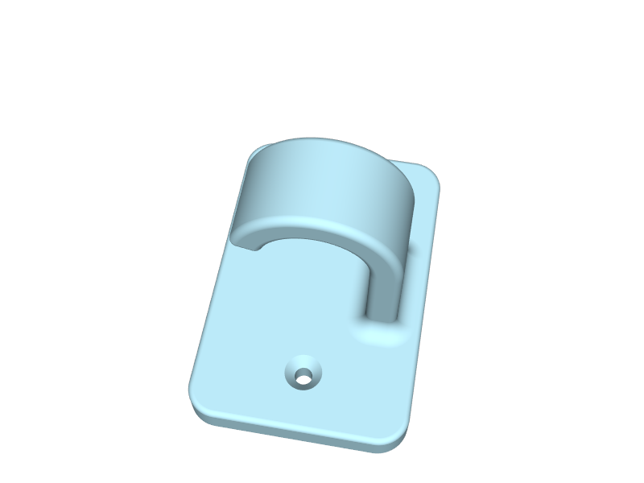

# Prayer room curtain rod: mid-span ceiling hook

A 3D-printed ceiling bracket that supports the middle of a 1 in curtain rod
where the wall above the window is too short for a normal bracket. A crossbar
plate screws to the ceiling along the rod and an open J-hook hangs from its
middle; the rod drops into the hook from the room side and rests on it.

| In place (view along the rod) | From below | Underside |
| --- | --- | --- |
|  |  |  |

Files:

- `scripts/ceiling_rod_hook.py` — the design, as a parametric build123d script (single source of truth)
- `output/ceiling_rod_hook.stl`, `.3mf` — print files, already in print orientation
- `output/ceiling_rod_hook.step` — CAD model in design coordinates (ceiling at z = 0, hook hanging below)

## Design basis

Measured on site (converted from inches):

| Measurement | Value |
| --- | --- |
| Rod diameter at the support spot | 1.0105 in = 25.67 mm |
| Ceiling to underside of rod at the end brackets (outside of cup minus 0.1315 in cup thickness) | 1.9615 in = 49.8 mm (right), 1.9745 in = 50.15 mm (left) |
| Ceiling to underside of rod at the support spot, unsupported | 2.2265 in = 56.55 mm (rod sags 6.7 mm) |
| Wall to room-side face of the rod | 3.95 in = 100.3 mm (rod centreline 87.5 mm from the wall) |

The hook cradle sits **2 mm higher** than the straight line between the end
brackets (`cradle_bias`): the rod's underside rests 47.8 mm below the ceiling
at the hook instead of 49.8 mm. The rod is lifted onto the hook, so the hook
carries its share of the weight instead of the rod sagging past it. This bias
also covers ceiling texture under the plate and print tolerance. Lifting the
middle 2 mm against a 6.7 mm sag keeps both end brackets loaded (about 80 %
of the weight goes to the hook, the rest to the ends).

## Key dimensions

| Feature | Value |
| --- | --- |
| Plate | 84 mm along the rod × 56 mm × 8 mm thick, corners R8, centred on the rod and the hook |
| Hook | 24 mm wide, 8 mm walls, stem on the wall side, opens toward the room |
| Cradle | Ø26.27 mm (0.3 mm radial clearance), lowest point 47.8 mm below the ceiling |
| Lip | rises 9.7 mm above the cradle bottom on the room side |
| Lowest point of the hook | 55.8 mm below the ceiling |
| Screws | 2 × Everbilt #10-12 × 1-1/4 in pan-head screws with ribbed plastic anchors; Ø6.2 through, Ø12 × 2.5 mm counterbore for the head, 54 mm apart on the rod's centreline; 9 mm of plate from the counterbore to the nearest end and to the hook, 22 mm to the sides |
| Mass | 63 g in PLA (solid) |

Load path: the rod's weight enters the cradle, runs up the stem into the plate,
and the plate spans between the two screws with the load between them, so
the screws see only tension, no prying. With a 4 kg share of rod and curtain
weight the stem carries about 3 MPa in bending and the plate about 1.3 MPa,
far below PLA's strength and low enough that creep is not a concern.

## Printing

- Material: PLA is fine at this stress level. 4 perimeters, 40 % or more
  infill (or solid; it is only 63 g).
- Orientation: the STL/3MF are already oriented with the flat ceiling face on
  the bed and the hook rising as a crook. The crook's underside and the lip
  need supports (organic/tree supports work well; they land on the plate's
  face and on the bed). The supported surface is where the rod rests and is
  hidden by the rod, so support marks do not matter.
- Layer height 0.2 mm. No brim needed; the plate is the bed contact.



## Installation

The screw centres sit **87.5 mm (3.44 in) from the window wall**, on the
line of the marked support spot, 27 mm either side of it. The plate spans
59.5 mm to 115.5 mm (2.34 in to 4.55 in) from the wall.

1. Take the rod down (lift the ends out of the end brackets; the curtains can
   stay on it).
2. Hold the bracket against the ceiling with the hook's open side toward the
   room, centred on the marked spot, and mark the two screw holes through
   the plate; or mark them directly at 87.5 mm from the wall, 54 mm apart.
3. Take the plate down and drill the anchor holes with the bit size printed
   on the back of the anchor pack (larger than the plate's holes, so the
   plate is a marking template, not a drill guide). Tap the ribbed anchors in
   flush. If the drill finds a joist, skip the anchor there and drive the
   screw straight into the wood.
4. Screw the bracket up with the pan-head screws from the pack. The plate's
   flat face goes against the ceiling; it sits on the texture peaks and pulls
   down tight. The heads seat flat in the counterbores; stop when they seat.
   The pack's 23 lb rating is for shear in a wall; on a ceiling the anchors
   are loaded in pull-out, which is lower, so keep both screws in anchors or
   wood and do not hang anything else off the rod's middle.
5. Put the rod back: seat one end in its bracket, swing the free end toward
   the room so the middle of the rod is on the room side of the hook's lip,
   lift the middle about 10 mm above its final height, push it toward the wall
   until it touches the stem, and lower it into the cradle. Then seat the free
   end.
6. Check: the rod should sit 2 mm high at the hook and both ends must still
   bear in their brackets. If an end lifts out of its bracket, the hook is too
   short for this ceiling: add a 1 mm washer at each screw between the plate
   and the ceiling per millimetre of drop needed. If the rod does not touch
   the cradle, the hook is too long: reprint with a larger `cradle_bias`.

## Regenerating the model

The script has PEP 723 metadata, so from the repo root:

```sh
uv run scripts/ceiling_rod_hook.py
```

writes the three files in `output/`. Every dimension is a named parameter at
the top of the script; the ones most likely to change:

| Parameter | Effect |
| --- | --- |
| `cradle_bias` | how much higher than the end brackets the rod sits at the hook |
| `rod_d` | rod diameter the cradle is sized for |
| `stem_on` | `"wall"` (default) or `"room"`: which side the stem drops on; the hook opens toward the other side |
| `screw_x` | half the screw spacing along the rod |
| `wall_t`, `hook_w`, `plate_t` | how much material the hook and plate carry |

The same script runs inside the build123d MCP session with `execute_file()`,
where `result` is the bracket in design coordinates and `print_part` the
print-oriented copy.
