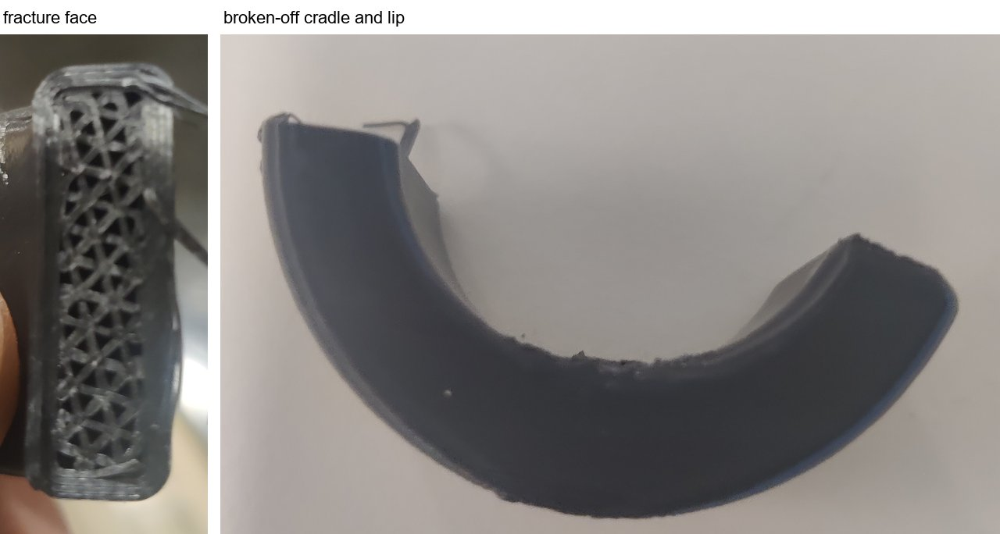
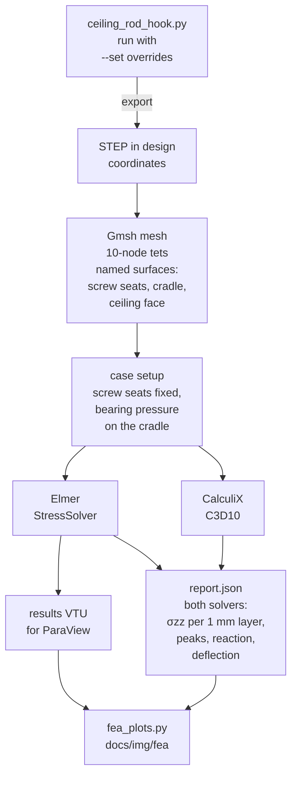
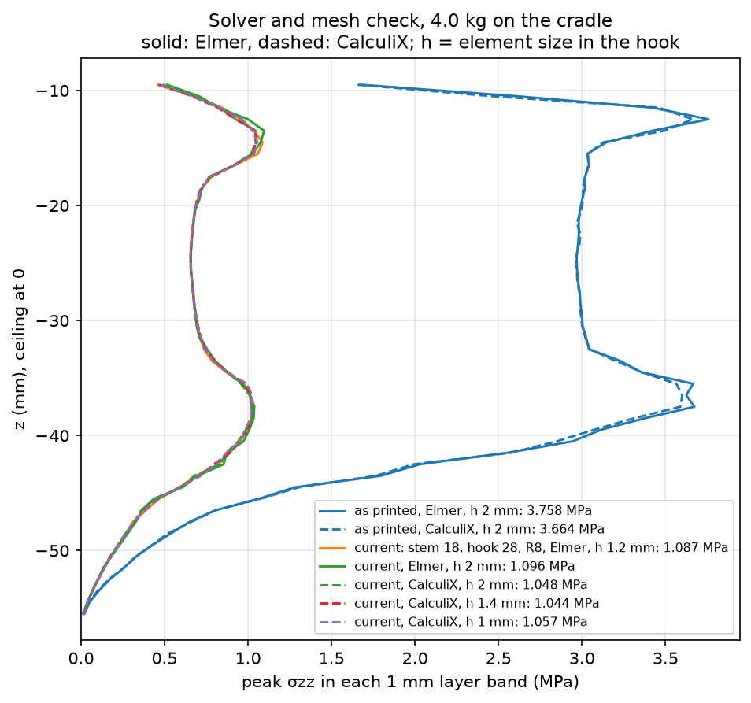
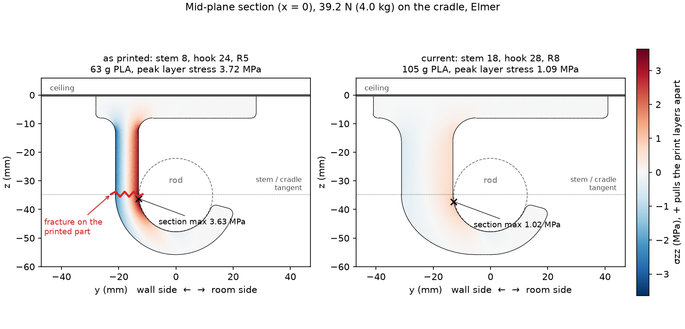
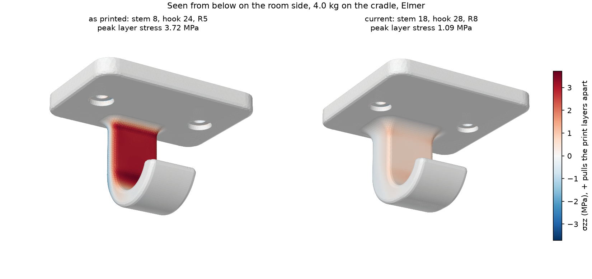
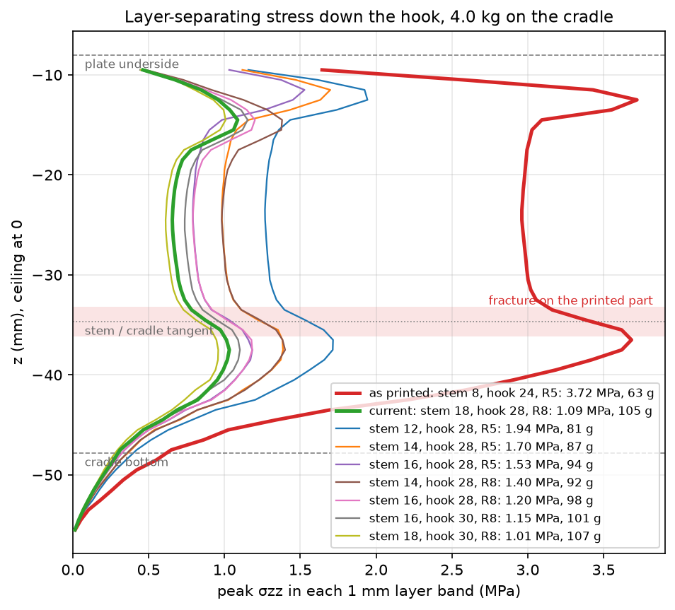
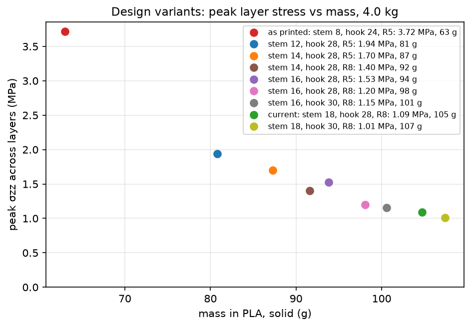

# FEA of the ceiling rod hook

Linear-static finite-element analysis of the bracket with Elmer, cross-checked
with CalculiX, to find why the printed hook broke and to size the change.

## Summary

- The printed part (8 mm stem, 24 mm wide hook, R5 root fillet) separated
  along one print layer where the stem turns into the cradle, on the wall side.
  The cradle and lip came off in one piece.
- Printed with the ceiling face on the bed, the layers are horizontal and the
  stem's bending stress σzz acts straight across them. With 4 kg on the
  cradle, that geometry puts 3.72 MPa across the layers at the root fillet
  under the plate and 3.68 MPa just below the stem/cradle tangent, where it
  broke.
- The current design keeps the hole pattern, the cradle, the lip and the rod
  position. It deepens the stem from 8 mm to 18 mm toward the wall, tapers its
  outer wall along an ellipse into the 8 mm cradle wall, widens the hook to
  28 mm, enlarges the root fillet to R8, and widens the plate to 82 mm across
  the rod to carry it. Peak layer stress drops from 3.72 to 1.09 MPa (−71 %),
  deflection from 0.51 mm to 0.10 mm, and the mass rises from 63 g to 105 g.
- Print it solid. The fracture face shows a thin perimeter shell around sparse
  infill, which leaves even less layer area to carry the bending.



## Model



| Item | Setting |
| --- | --- |
| Geometry | `scripts/ceiling_rod_hook.py`, executed by `scripts/fea_hook.py` with parameters replaced by `--set NAME=VALUE`, so the analysis runs on the model that is exported for printing |
| Mesh | Gmsh, 10-node tetrahedra; 1.2 mm in the hook and around the screw seats, 3 mm elsewhere (70 k elements for the 8 mm stem, 123 k for the current design) |
| Material | Isotropic linear-elastic PLA, E = 2.3 GPa, ν = 0.35. Stresses do not depend on E here (one material, force loads, fixed supports); deflections scale with 1/E |
| Supports | The two counterbore floors under the pan heads, fixed in x, y and z |
| Load | 4 kg (39.2 N) on the cradle as a radial bearing pressure p0·cos(90°·φ/30°) over ±30° about the bottom; the README design basis puts about 80 % of the rod and curtain weight on the hook |
| Output | σzz, the stress normal to the print layers (+ pulls them apart), its peak in every 1 mm band of z down the hook, and the two maxima of that profile: "root", above mid-stem (z = −21.3 mm), at the root fillet, and "shoulder", below it, where the stem turns into the cradle (tangent at z = −34.7 mm) |
| Solvers | Elmer 26.1 `StressSolver` (CG, ILU0) and CalculiX 2.22 `C3D10` on the same mesh and loads |

## Validation



- Equilibrium: the support reaction matches the applied 39.24 N to 0.2 %
  (0.5 % for the ±15° contact below, whose narrower pressure table Elmer
  integrates less exactly).
- Two solvers on one mesh (2 mm elements): the as-printed root peak is
  3.76 MPa in Elmer and 3.66 MPa in CalculiX, the current design's 1.10 and
  1.05 MPa. Over the whole hook the RMS difference in σzz is 0.6 % and 0.4 %
  of the peak; the peaks differ more because each solver turns element
  stresses into nodal values differently at the root fillet's corner, where
  it wraps around the stem's edge round.
- Mesh (current design): CalculiX gives root peaks of 1.05, 1.04 and 1.06
  MPa with 2, 1.4 and 1.0 mm elements (75 k to 287 k nodes), Elmer 1.10 and
  1.09 MPa with 2 and 1.2 mm. The shoulder stays at 1.02 to 1.04 MPa
  throughout. The results below use Elmer at 1.2 mm, the high end.
- Boundary conditions (2 mm elements): also holding the plate's ceiling face
  in z, the stiffest the ceiling contact can be, moves the as-printed root
  peak from 3.76 to 3.81 MPa and lowers the current design's from 1.10 to
  0.88 MPa, which leaves its shoulder (1.04 MPa) to govern; the shoulder
  peaks do not move. Narrowing the bearing pressure to ±15° changes the peaks
  by under 0.5 %. The hook's stresses are fixed by statics; the support and
  contact assumptions barely move the governing peak.

## Results







Elmer, 1.2 mm elements, 4 kg on the cradle; root and shoulder as defined
under Model.

| Stem depth (mm) | Hook width (mm) | Root fillet | Mass (g) | Root (MPa) | Shoulder (MPa) | Deflection (mm) |
| --- | --- | --- | --- | --- | --- | --- |
| 8, as printed | 24 | R5 | 63.0 | 3.72 | 3.68 | 0.51 |
| 12 | 28 | R5 | 80.8 | 1.94 | 1.72 | 0.20 |
| 14 | 28 | R5 | 87.3 | 1.70 | 1.39 | 0.16 |
| 14 | 28 | R8 | 91.6 | 1.38 | 1.40 | 0.14 |
| 16 | 28 | R5 | 93.8 | 1.53 | 1.18 | 0.13 |
| 16 | 28 | R8 | 98.1 | 1.20 | 1.18 | 0.12 |
| 16 | 30 | R8 | 100.6 | 1.15 | 1.10 | 0.11 |
| **18, current** | **28** | **R8** | **104.7** | **1.09** | **1.03** | **0.10** |
| 18 | 30 | R8 | 107.4 | 1.01 | 0.96 | 0.10 |



- The rod's weight hangs 17 mm from the centre of an 8 mm stem, so the stem
  carries a bending moment along its whole length. The layer stress peaks at
  the root fillet and again just below the tangent, where the section starts
  to curve and the curved-beam effect concentrates stress on the rod-side
  face. The two peaks are nearly equal (3.72 and 3.68 MPa), and the part
  broke at the second.
- Bending stress falls with the square of the stem's depth. Deepening the stem
  toward the wall leaves the rod's side of the hook, the cradle and the lip
  where they are, and the wall has room for it. With an R5 fillet the root
  then governs; R8 brings it down to the shoulder's level.
- Past an 18 mm stem and a 28 mm hook the gain is a few percent for each extra
  gram, so the current design stops there.
- The plate carries its bending in the plane of its layers: peak principal
  stress 1.55 MPa for the 8 mm stem and 0.85 MPa now.

## Strength margin

The Prusament PLA technical data sheet (Prusa Polymers, v1.0; ISO 527, 100 %
infill, 0.2 mm layers) gives a yield strength of 37.6 ± 4.0 MPa for bars
printed upright, loaded across the layers, against 50.8 MPa for bars printed
flat.

| | 8 mm stem | Current design |
| --- | --- | --- |
| Layer stress per kg on the hook | 0.93 MPa | 0.27 MPa |
| Load on the hook at 37.6 MPa, solid print | about 40 kg | about 140 kg |

These figures assume solid, well-bonded layers. The broken part's thin
perimeter shell and sparse infill carry the bending on a hollow section; with
two or three perimeters that raises the stress in the shell 1.3 to 1.8 times,
and layer bonds from cool or fast printing fall well short of the data sheet.
The rod's weight alone should not break a solid print of the 8 mm stem. A
sparse, weakly bonded print plus a short overload, such as a tug on the
curtain or levering the rod while seating it, explains the failure. The
current geometry has 3.4 times the margin of the 8 mm stem for the same print
quality; printing it solid adds the rest.

## Not modelled

- Print anisotropy: the stress field comes from an isotropic model and is
  compared with the across-layer strength.
- Rod-to-cradle contact (a prescribed pressure), screw and anchor compliance
  (seats fixed), and the compression-only ceiling contact (bracketed by the
  bonded-ceiling case above).
- Creep, fatigue and print defects.

## Reproducing

Elmer (`ElmerSolver`, `ElmerGrid`) must be on `PATH`, and the checks need
CalculiX, e.g. the `ccx.exe` in FreeCAD's `bin` folder. Each case is a
directory under the system temp folder (`prayer-room-bracket-fea`,
`--workdir` to change) holding `report.json`, the solver logs and the Elmer
result VTU for ParaView.

The whole study, which redraws `docs/img/fea` and prints every number quoted
here, takes about 40 minutes; its 1.0 mm CalculiX case needs 9 GB of memory:

```sh
uv run scripts/fea_study.py --ccx "C:/Program Files/FreeCAD 1.1/bin/ccx.exe"
```

A single case takes about five minutes in Elmer; `fea_plots.py` then draws
its plots under the work directory:

```sh
uv run scripts/fea_hook.py --name current
uv run scripts/fea_hook.py --name wide --set hook_w=30.0
uv run scripts/fea_plots.py --proposed current current wide
```

`--load-kg` sets the load (stresses scale linearly with it), `--contact-deg`
the bearing half-angle and `--ceiling bonded` the stiff ceiling bound.
